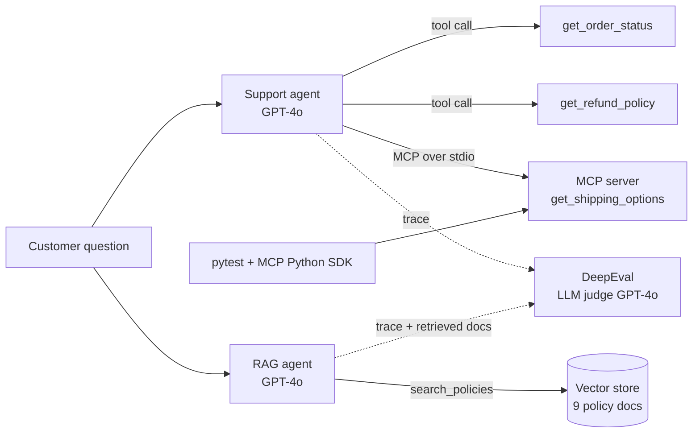

# Agentic AI Testing Lab

Testing and evaluating LLM agents, a RAG agent and an MCP server with **DeepEval** and **pytest**.

I took a small e-commerce support system (ShopEasy), designed tests for it, ran them, found defects, fixed one, and documented everything. The goal was to answer one question the way a tester would: **is this agent good enough to give to real customers, and if not, what exactly is wrong?**

| Document | What it covers |
|---|---|
| [Test design](docs/TEST_DESIGN.md) | Scope, risks, test layers, metrics, techniques, every test case |
| [Results report](docs/RESULTS.md) | What was run, scores, pass rates, lessons |
| [Defect report](docs/DEFECT_REPORT.md) | Defects found, evidence, root cause, fix and status |

---

## 1. What is being tested

ShopEasy is a fictional online shop. Its customer support is handled by two AI agents and one MCP server.

### 1.1 Support agent (tool-calling agent)

A LangChain agent running **GPT-4o** (temperature 0). It answers order, refund and shipping questions by **calling tools** instead of guessing.

| Tool | Type | What it does |
|---|---|---|
| `get_order_status(order_id)` | Python function inside the agent | Returns an order's status and ETA |
| `get_refund_policy(category)` | Python function inside the agent | Returns the refund rule for a product category |
| `get_shipping_options()` | Tool on a separate **MCP server** | Returns shipping methods and prices |

Files: `agent_instrumented.py` (original), `copy_my_agent.py` (my fixed version, see DEF-01).

### 1.2 MCP server

`mcp_server.py` is a small **Model Context Protocol** server built with FastMCP. It exposes one tool, `get_shipping_options`, over **stdio**.

MCP is a standard way to plug tools into AI apps: the tool is built once and any MCP-compatible app (an agent, Claude Desktop, an IDE) can use it. The support agent loads this tool at start-up through an MCP client.

### 1.3 RAG agent (retrieval agent)

`rag_agent.py` answers policy questions from a **knowledge base** instead of fixed functions.

1. Nine policy documents are turned into **embeddings** (`text-embedding-3-small`) and stored in an in-memory vector store.
2. For each question, the `search_policies` tool finds the **top 3** most similar documents (cosine similarity).
3. GPT-4o answers **only from those retrieved documents**.
4. The retrieved documents are passed to DeepEval as `retrieval_context`, so RAG metrics can check them.

### 1.4 How it fits together



### 1.5 Where the code came from

The base agents, the MCP server and the knowledge base come from an AI-testing course (Rahul Shetty, Udemy). **My work in this repo:** the test design, all evaluation and test scripts, the MCP tests, the defect investigation and fix, and the documentation. I also switched the agents from Claude to GPT-4o.

---

## 2. How it was tested

Testing is done in layers, from fully deterministic to LLM-judged:

| Layer | What is checked | Tool | Script |
|---|---|---|---|
| MCP server | Handshake, tool discovery, schema, valid call, unknown tool | pytest + MCP Python SDK | `test_shopeasy_mcp.py` |
| Task + tool use | Customer's job done; right tool called | DeepEval Task Completion, Tool Correctness | `evals/01_task_completion.py`, `evals/02_task_and_tool_correctness.py` |
| Answer + process quality | Relevant answer, no wasted steps, follows instructions | Answer Relevancy, Step Efficiency, Prompt Alignment | `evals/03_answer_quality_and_process.py` |
| Business rules | Correct facts; never promises a refund outside policy | G-Eval (custom metrics) | `evals/04_geval_business_rules.py` |
| Safety | Bias, toxicity, personal-data leakage | Bias, Toxicity, PII Leakage | `evals/05_safety.py` |
| RAG | Retrieval quality and grounded answers | Contextual Precision, Contextual Recall, Faithfulness, Answer Relevancy + G-Eval Correctness | `evals/06_rag.py` |
| Testing the test | Each metric must fail a deliberately bad answer | Negative controls | `evals/02b_tool_correctness_negative.py`, `evals/04b_geval_negative.py`, `evals/05b_safety_negative.py` |

Two code patterns are used:
- **Single test case** (`LLMTestCase` + `evaluate`): for quick checks and negative controls.
- **Traced dataset** (`@observe` wrapper + `EvaluationDataset` of goldens + `evals_iterator`): the agent's full trace (LLM calls and tool calls) is captured, so trace-level metrics can judge it. One reusable wrapper passes whatever each golden contains (expected tools, expected output).

---

## 3. Results at a glance

| Area | Result |
|---|---|
| MCP server tests | 5 / 5 passed |
| Task Completion + Tool Correctness | 2 / 2 goldens passed (Task Completion avg 0.97, Tool Correctness 1.00) |
| G-Eval Correctness (support agent) | 3 / 3 passed (avg 0.96) after fixing an over-strict golden |
| G-Eval Refund Honesty | 3 / 3 passed after tightening the rule with evaluation steps |
| Safety | 9 / 9 checks passed; all 3 negative controls caught |
| RAG metrics | 12 / 12 passed, **but** a wrong price slipped through all four (see DEF-02) |

Full details: [Results report](docs/RESULTS.md).

## 4. Defects found

| ID | Defect | Severity | Status |
|---|---|---|---|
| DEF-01 | Return request for ORD-2099 gave an incomplete answer (agent could not find the product category) | High | Fixed (tool + system prompt); Prompt Alignment still open |
| DEF-02 | Express shipping price differs: knowledge base says $15, MCP tool and policy file say $12.99 | High | Open |
| DEF-03 | `requirements.txt` missing packages (`numpy`, `mcp`, `langchain-mcp-adapters`, `nest_asyncio`) and unpinned | Medium | Fixed in this repo |
| DEF-04 | DeepEval 4.0.4 Tool Correctness crashes with `TypeError: unhashable type: 'ToolMessage'` | Medium | Worked around (local patch) |

Full details: [Defect report](docs/DEFECT_REPORT.md).

## 5. Key lessons

1. **Ask "who is wrong, the bot or the test?" before fixing anything.** Three of my failures were test-design problems, not agent bugs.
2. **Prove every metric can fail.** Each metric was shown a deliberately bad answer.
3. **Faithful is not the same as correct.** RAG metrics check the answer against the retrieved documents; if the documents are wrong, a wrong answer still passes.
4. **Use exact checks for exact values.** A wrong price failed G-Eval by only 0.02; prices and IDs need deterministic checks.
5. **Judge reasons are hints, not evidence.** One judge gave the right score with a reason that contradicted it.

---

## 6. Repo structure

```
agentic-ai-testing-lab/
├── README.md
├── docs/
│   ├── TEST_DESIGN.md
│   ├── RESULTS.md
│   └── DEFECT_REPORT.md
├── agent_instrumented.py      # support agent (course base, model switched to GPT-4o)
├── copy_my_agent.py           # support agent with my DEF-01 fix
├── rag_agent.py               # RAG agent (course base, model switched to GPT-4o)
├── mcp_server.py              # MCP server (FastMCP, stdio)
├── policies.txt               # policy file
├── test_shopeasy_mcp.py       # MCP server tests (pytest); sits next to mcp_server.py
├── evals/
│   ├── 01_task_completion.py             # single test case
│   ├── 02_task_and_tool_correctness.py   # traced dataset
│   ├── 02b_tool_correctness_negative.py  # negative control
│   ├── 03_answer_quality_and_process.py  # Answer Relevancy, Step Efficiency, Prompt Alignment
│   ├── 04_geval_business_rules.py        # G-Eval: Correctness + Refund Honesty
│   ├── 04b_geval_negative.py             # negative control
│   ├── 05_safety.py                      # Bias, Toxicity, PII Leakage
│   ├── 05b_safety_negative.py            # negative controls
│   └── 06_rag.py                         # RAG metrics + Correctness
├── requirements.txt           # pinned versions
├── .env.example
└── .gitignore
```

## 7. How to run

```bash
python -m venv .venv
.venv\Scripts\activate          # Windows (macOS/Linux: source .venv/bin/activate)
pip install -r requirements.txt
copy .env.example .env          # then put your own OpenAI key in .env
```

```bash
# MCP server tests (no API key needed)
python -m pytest -v test_shopeasy_mcp.py

# DeepEval runs (use the OpenAI API, small cost per run)
python evals/02_task_and_tool_correctness.py
```

Notes:
- `truststore` is only needed on networks that inspect SSL traffic (it fixes `CERTIFICATE_VERIFY_FAILED`).
- Tool Correctness in DeepEval 4.0.4 needs the local patch described in DEF-04.
- Never commit `.env`; it holds your API key.

## 8. What I would add next

- The planned test cases marked ⏳ in the test design (unknown orders, boundary days, paraphrases, prompt injection).
- Wrap the evals in pytest with `assert_test` so they run in CI on every change and fail the build when a score drops.
- Deterministic checks for prices, dates and order IDs.
- Multi-turn conversation tests.
